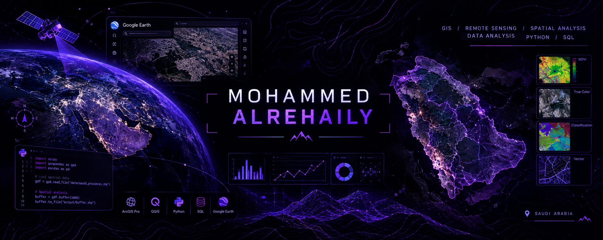

Hi, I'm Mohammed Alrehaily 👋

  

GIS & RS Specialist | Spatial Data Analysis | DATA Analysis

I'm a Saudi GIS graduate from Umm Al-Qura University, passionate about Geographic Information Systems, remote sensing, and geospatial data analysis. I’m also interested in programming, application development, process automation, and data analysis, exploring how technology and data can be leveraged to support business operations, improve efficiency, and enhance decision-making.

I have practical experience in spatial data digitization, geodatabase management, and topology analysis. I continuously strive to develop my SQL and Python skills and integrate them into workflows and Geographic Information Systems (GIS).

Software

       

Technical Skills

GIS 🌐

Geographic Information Systems (GIS)

Spatial Data Digitization

Spatial Analysis & Geoprocessing

Geodatabase Management

Topology Analysis

Cartography & Map Production

RS 🛰️

Satellite Imagery Processing & Analysis

Satellite Imagery Data Acquisition

Image Classification

Databases: SQL, Microsoft SQL Server

Programming: Python (Beginner)

Other Tools: Google Earth, Microsoft Office

📌 Areas of Interest

Geographic Information Systems (GIS)

Remote Sensing and Satellite Imagery

Spatial Database Management

Geospatial Data Quality and Analysis

SQL and Python for Geospatial Applications

🚀 Currently Learning

SQL and Database Design

python 
arc py

📂 Featured Projects

Coming soon! I'm working on building a portfolio of GIS, remote sensing, and spatial database projects.

📫 Connect With Me

LinkedIn: Add your LinkedIn URL

Email: Add your professional email

Always learning, mapping, and exploring the world through geospatial technology. 🌍
